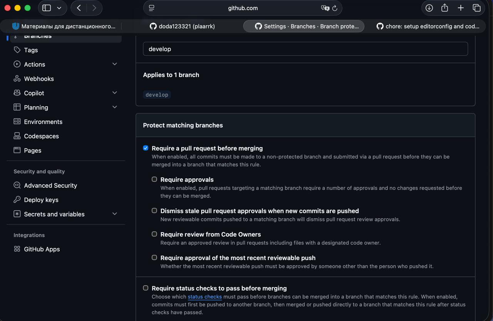
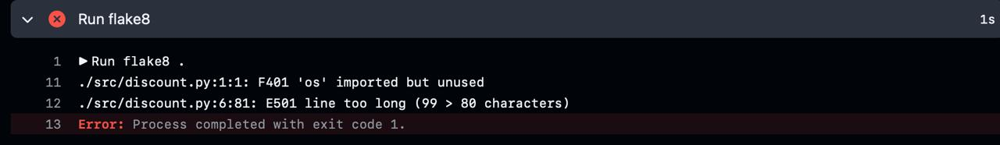
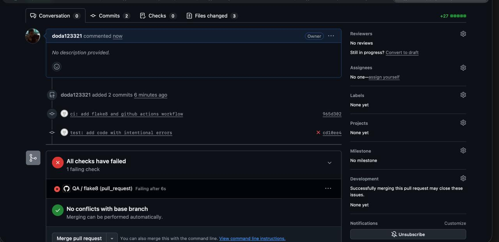
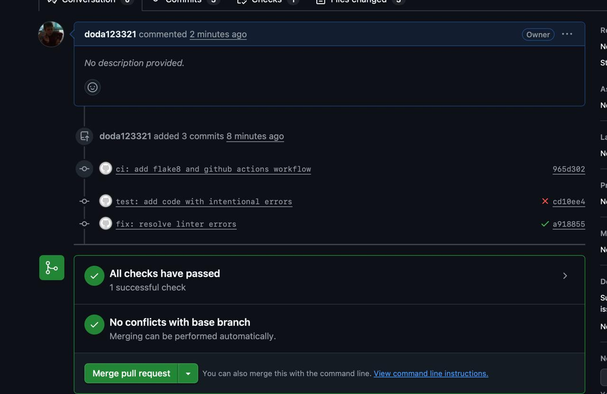

# Итоговый аналитический отчет (Лабораторная работа №1)

Дисциплина: Моделирование и анализ программного обеспечения
Автор: Игнаткин (GitHub: [doda123321](https://github.com/doda123321))

## 1. Резюме (Executive Summary)

Цель проекта - спроектировать процесс разработки микросервиса «Расчет корзины и скидок» для системы лояльности: выбрать СУБД, настроить репозиторий и командные стандарты, внедрить автоматический контроль качества кода, проанализировать legacy-алгоритм расчета скидок и подготовить план code-review.

Основные достижения:

- Проведен взвешенный сравнительный анализ PostgreSQL и MongoDB. Выбрана **PostgreSQL** (4.40 балла против 3.60).
- Создан публичный репозиторий с моделью ветвления `main` / `develop` / `feature/*`, настроены `.editorconfig`, `CODEOWNERS` и защита ветки `develop`.
- Настроен CI на GitHub Actions с линтером flake8, продемонстрирована работа Quality Gate (красный, затем зеленый статус).
- Построена UML-диаграмма деятельности legacy-функции `calculate_cart_total`, выявлены «запахи кода», составлен план ревью.

Репозиторий: https://github.com/doda123321/lab1-comprehensive-Ignatkin

## 2. Сравнительный анализ технологий

Контекст: СУБД нужна для хранения истории транзакций, баллов лояльности и промокодов. Кандидаты: PostgreSQL (реляционная) и MongoDB (документоориентированная).

### 2.1. Матрица принятия решений

Оценки по 5-балльной шкале (5 - лучше всего).

| № | Критерий | Вес | PostgreSQL | MongoDB |
|---|----------|-----|-----------|---------|
| 1 | Поддержка ACID-транзакций | 0.35 | 5 | 3 |
| 2 | Целостность данных (схема, ограничения, внешние ключи) | 0.20 | 5 | 3 |
| 3 | Производительность чтения | 0.15 | 4 | 4 |
| 4 | Гибкость схемы (разные типы промокодов) | 0.15 | 3 | 5 |
| 5 | Экосистема и стоимость владения | 0.15 | 4 | 4 |
| | **Сумма весов** | **1.00** | | |

### 2.2. Расчет и обоснование выбора

Формула: **Оценка = Σ (Вес_критерия × Балл_кандидата)**

PostgreSQL:
0.35·5 + 0.20·5 + 0.15·4 + 0.15·3 + 0.15·4 = 1.75 + 1.00 + 0.60 + 0.45 + 0.60 = **4.40**

MongoDB:
0.35·3 + 0.20·3 + 0.15·4 + 0.15·5 + 0.15·4 = 1.05 + 0.60 + 0.60 + 0.75 + 0.60 = **3.60**

Обоснование весов: сервис работает с баллами и денежными расчетами, поэтому максимальный вес (0.35) у ACID: списание и начисление баллов должны быть атомарными. Второй по важности критерий - целостность данных (0.20): ограничения и внешние ключи защищают от некорректных записей. Производительность чтения, гибкость схемы и экосистема важны, но вторичны (по 0.15).

Вывод: побеждает **PostgreSQL**. Недостаток гибкости схемы компенсируется типом JSONB для нестандартных атрибутов промокодов. MongoDB поддерживает многодокументные транзакции, но для финансовых операций это менее зрелое и более затратное решение.

## 3. Архитектура и контроль версий

### 3.1. Настройка репозитория

Репозиторий: https://github.com/doda123321/lab1-comprehensive-Ignatkin (публичный).

Модель ветвления:

- `main` - стабильная базовая ветка (README.md);
- `develop` - ветка интеграции, создана от `main`;
- `feature/infrastructure` - стандарты и владельцы кода (от `develop`);
- `feature/qa-gates` - линтер и CI (от `develop`);
- `feature/review-plan` - план ревью и UML (от `develop`).

Все изменения попадают в `develop` только через Pull Request:

- PR #1 `feature/infrastructure` → `develop` (слит), коммит [bef7ebf](https://github.com/doda123321/lab1-comprehensive-Ignatkin/commit/bef7ebf) `chore: setup editorconfig and codeowners`;
- PR #2 `feature/qa-gates` → `develop` (слит);
- PR #3 `feature/review-plan` → `develop` (открыт) - https://github.com/doda123321/lab1-comprehensive-Ignatkin/pull/3

### 3.2. Контроль доступа

Файл `.github/CODEOWNERS`:

```
* @doda123321
```

Файл `.editorconfig`: кодировка UTF-8, отступ 4 пробела, переносы строк LF.

Защита ветки `develop` (Require a pull request before merging):



## 4. Инструментальный контроль качества

### 4.1. Настройка CI/CD

Конфигурация пайплайна: [.github/workflows/qa.yml](https://github.com/doda123321/lab1-comprehensive-Ignatkin/blob/develop/.github/workflows/qa.yml). Пайплайн запускает flake8 при создании Pull Request в ветку `develop`. Правила линтера (`.flake8`): максимальная длина строки 80 символов.

Коммит настройки: [965d302](https://github.com/doda123321/lab1-comprehensive-Ignatkin/commit/965d302) `ci: add flake8 and github actions workflow`.

### 4.2. Работа Quality Gate

Метод «сломать и починить»:

1. Коммит [cd10ee4](https://github.com/doda123321/lab1-comprehensive-Ignatkin/commit/cd10ee4) `test: add code with intentional errors` добавил в `src/discount.py` неиспользуемый импорт `import os` и строку длиннее 80 символов. Проверка в PR #2 завершилась **красным статусом**.
2. Коммит [a918855](https://github.com/doda123321/lab1-comprehensive-Ignatkin/commit/a918855) `fix: resolve linter errors` удалил неиспользуемый импорт `import os` и сократил строку 6 до 80 символов или меньше. Проверка стала **зеленой**, после чего PR #2 был слит.

Текст ошибок линтера (шаг `Run flake8` в GitHub Actions):

```
./src/discount.py:1:1: F401 'os' imported but unused
./src/discount.py:6:81: E501 line too long (99 > 80 characters)
Error: Process completed with exit code 1.
```

Расшифровка: `F401` - импорт `os` не используется; `E501` - длина строки 6 равна 99 символам при допустимых 80.



Скриншоты PR #2:





## 5. Обратное проектирование и планирование ревью

### 5.1. Анализ алгоритма

Диаграмма деятельности функции `calculate_cart_total` (файл лежит в ветке `feature/review-plan`, PR #3):


[UML Diagram](docs/uml_diagram.png)

Выявленные «запахи кода» (Code Smells):

1. **Магические числа**: 15000, 0.85, 500, 0.90, 0.97, 0.93, 0.70 зашиты в код без имен и объяснений.
2. **Магические строки**: коды промокодов `"SUMMER"` и `"VIP"` и уровни `tier == 1/2` заданы литералами.
3. **Отсутствие валидации входных данных**: нет проверок `cart_sum >= 0`, допустимых значений `tier`, типа и содержимого `promos`.
4. **Уязвимость к фроду**: один и тот же промокод в списке применяется повторно (например, `SUMMER` дважды дает -1000).
5. **Зависимость от порядка**: результат зависит от порядка скидок и промокодов, и это нигде не задокументировано.
6. **Возможная отрицательная цена**: вычитание 500 может увести цену ниже нуля до применения нижней границы.
7. **Деньги во float**: вычисления с плавающей точкой дают ошибки округления, нужно использовать `Decimal`.
8. **Цепочки if/elif**: добавление нового промокода или уровня потребует правки функции (нарушение принципа открытости/закрытости), лучше таблица правил.
9. **Функция делает слишком много**: базовая скидка, промокоды, лояльность и ограничение смешаны в одной функции без декомпозиции.
10. **Нет типов и документации**: отсутствуют аннотации типов и docstring, неясны единицы измерения и формат аргументов.

### 5.2. План code-review

Подход: ревью модуля `src/discount.py` через Pull Request в `develop` с обязательным зеленым CI и approve владельца кода.

Открытый Pull Request с планом ревью и UML-диаграммой: https://github.com/doda123321/lab1-comprehensive-Ignatkin/pull/3

План: [docs/review-plan.md](https://github.com/doda123321/lab1-comprehensive-Ignatkin/blob/feature/review-plan/docs/review-plan.md)

Ключевые измеримые критерии:

- отсутствие магических чисел (все пороги и коэффициенты в именованных константах);
- валидация входных данных (`cart_sum`, `tier`, `promos`);
- покрытие тестами модуля более 80%;
- flake8 проходит без ошибок.

Механизм эскалации: обсуждение в комментариях PR (до 2 итераций) → подключение второго ревьюера → окончательное решение Tech Lead, зафиксированное комментарием в PR.

## 6. Заключение

Настроенные процессы снижают риск внесения дефектов на нескольких уровнях:

- защита `develop` и обязательные Pull Request исключают прямые коммиты и дают точку контроля перед слиянием;
- `CODEOWNERS` гарантирует, что каждое изменение просмотрит ответственный;
- автоматический flake8 в CI отсекает стилистические ошибки и неиспользуемый код до ревью, что показал эксперимент «сломать и починить»;
- `.editorconfig` убирает споры о форматировании и шум в диффах;
- обратное проектирование и список code smells показали риски legacy-алгоритма (фрод через повторные промокоды, отсутствие валидации), а план ревью с измеримыми критериями и эскалацией превращает их в проверяемые требования;
- выбор PostgreSQL на основе взвешенной матрицы обеспечивает ACID-гарантии для финансовых операций.
